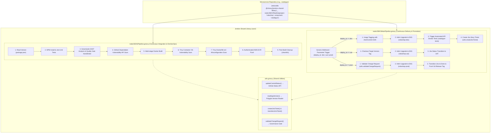
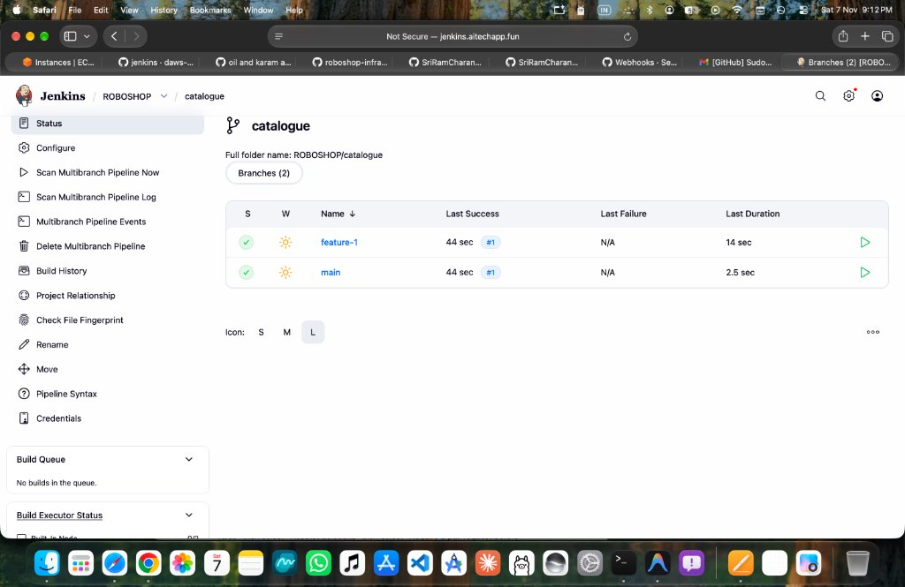

# RoboShop Enterprise Jenkins Shared Library (CI/CD & DevSecOps)

A centralized, reusable, and enterprise-grade **Jenkins Shared Library** for the **RoboShop E-Commerce Microservices Platform** deployed on **Amazon EKS (Kubernetes)**.

This repository implements the **DRY (Don't Repeat Yourself)** principle across all microservices (Node.js, Java, Python, Golang), eliminating duplicated Jenkinsfiles, standardizing security compliance gates (SonarQube SAST, GitHub Dependabot, Trivy Container/IaC Scanning), and providing automated multi-environment continuous deployment (`dev` ➔ `uat` ➔ `prod`) with Jira integration and Change Request governance.

---

## 🏗️ Architecture & High-Level Flow



---

## 📁 Repository Directory Structure

```
jenkins-shared-library/
├── README.md                      # Comprehensive architectural documentation
├── images/                        # CI/CD execution proof-of-work screenshots
│   └── 01-jenkins-shared-library-execution.png
└── vars/                          # Global pipeline steps and workflows
    ├── EKSPromotionalPipeline.groovy   # Lightweight promotional deployment pipeline
    ├── nodeJSEKSMainPipeline.groovy    # Multi-environment CD pipeline (dev, uat, prod with Jira/CR)
    ├── nodeJSEKSPipeline.groovy        # Full CI & DevSecOps security scanning pipeline
    ├── utils.groovy                    # Common helper functions (GitHub status, Jira, CR, Version)
    └── jenkins.env                     # Reference Jenkins agent environment variables
```

---

## 🛠️ Pipeline Modules & Capabilities

### 1. `vars/nodeJSEKSPipeline.groovy` — CI & DevSecOps Pipeline
A turnkey pipeline for Node.js microservices that enforces rigorous quality and security standards before any artifact is pushed to AWS ECR:

| Stage | Key Implementation Details | Security / Quality Standard |
| :--- | :--- | :--- |
| **Read Version** | Parses `package.json` dynamically using `readJSON`. | Semantic versioning enforcement. |
| **Install & Unit Tests** | Executes `npm install` and `npm test`. Calls `utils.updateCommitStatus()` to update the GitHub commit check in real-time. | Fail-fast execution; prevents broken code from advancing. |
| **SonarQube Analysis** | Invokes `sonar-scanner` within `withSonarQubeEnv('sonar-server')`. | Static Application Security Testing (SAST), code smells, bug detection. |
| **Quality Gate** | Pauses pipeline and waits for webhook callback with `waitForQualityGate()`. Fails pipeline if status `!= 'OK'`. | Hard circuit breaker; enforces strict quality thresholds. |
| **Dependabot Scan** | Queries GitHub REST API (`/repos/${repoPath}/dependabot/alerts`) with bearer token. Aborts build if any `HIGH` or `CRITICAL` library vulnerability is detected. | Software Bill of Materials (SBOM) & Third-Party Dependency Scanning. |
| **Docker Build** | Builds multi-stage Docker image and tags with semantic version. | Minimal attack surface (Alpine base image). |
| **Trivy OS Scan** | Runs `trivy image --scanners vuln --pkg-types os --severity HIGH,MEDIUM --exit-code 1`. Generates table report `trivy-os-report.txt`. | Operating System CVE vulnerability scanning. |
| **Trivy Dockerfile Scan** | Runs `trivy config --severity HIGH,MEDIUM --exit-code 1 Dockerfile`. | Container IaC misconfiguration and root-user prevention. |
| **Push to ECR** | Authenticates via `aws ecr get-login-password` and pushes image to Amazon ECR. | Secure OCI registry storage with IAM credentials. |
| **Workspace Cleanup** | Executes `cleanWs()` in `post { always { ... } }`. | Ephemeral runner hygiene; prevents disk saturation. |

---

### 2. `vars/nodeJSEKSMainPipeline.groovy` — CD & Multi-Environment Promotion
An enterprise-grade continuous deployment pipeline supporting automated environment promotion from Development to Production:

- **Generic Webhook Triggering**:
  Configured with `GenericTrigger` to receive incoming webhooks from **Jira Automation** or developer triggers with tokens `${project}-main-pipeline`.
- **Environment Promotion Flow**:
  1. **DEV Environment**:
     - Pulls image from ECR, retags with immutable short commit SHA (`${shortCommit}`), and pushes to ECR.
     - Performs atomic Helm upgrade into EKS namespace `roboshop-dev` (`helm upgrade --install ... -f values-dev.yaml --atomic --wait --timeout=5m`).
     - Triggers downstream integration test job (`${project}/${component}-tests`) to perform automated post-deployment API verification.
     - Automatically creates a Jira Story ticket (`utils.createJiraTicket`) linking the component, app version, and commit SHA for UAT tracking.
  2. **UAT Environment**:
     - Triggered automatically via Jira status webhook when QA approves the ticket.
     - Checks out the exact Git commit SHA (`git checkout ${TARGET_VERSION}`).
     - Upgrades Helm deployment in `roboshop-uat` namespace (`values-uat.yaml`).
  3. **PROD Environment**:
     - **Change Management Governance**: Enforces mandatory Change Request validation (`utils.validateChangeRequest(CR_NUMBER)`). If the CR is not approved in ServiceNow/ITSM or is outside the scheduled change window, deployment is immediately aborted.
     - Upgrades Helm deployment in `roboshop-prod` namespace (`values-prod.yaml`).
     - Automatically transitions the Jira ticket to **Done**.
     - Generates and pushes an immutable Git release tag (`git tag $APP_VERSION && git push origin $APP_VERSION`).

---

### 3. `vars/utils.groovy` — Reusable Utility Functions

| Function | Purpose & Implementation |
| :--- | :--- |
| `updateCommitStatus(state, description, context)` | Calls the GitHub Commit Status API via `curl` to dynamically update PR checks (`pending`, `success`, `failure`) directly on GitHub. |
| `readAppVersion()` | Polyglot version detector. Dynamically inspects the workspace and extracts application version from `package.json` (Node.js), `pom.xml` (Java Maven), or `version.txt` (Python). |
| `createJiraTicket(project, component, appVersion, shortCommit)` | Uses the Jira Pipeline Steps plugin (`jiraNewIssue`) to create structured Jira stories populated with component metadata and sprint assignment. |
| `transitionJiraTicket(issueKey, transitionName)` | Queries available Jira issue transitions dynamically (`jiraGetIssueTransitions`) and executes the transition by name (e.g., `'UAT Success'`, `'Done'`). |
| `validateChangeRequest(crNumber)` | Enterprise release gate ensuring that production deployments are authorized by an approved ITSM Change Request (ServiceNow/Remedy API integration pattern). |

---

## 📸 Proof-of-Work & Pipeline Execution

Below is an example of a microservice pipeline execution using this shared library, showcasing automated branch discovery, SonarQube quality gate verification, and multi-stage container building:



---

## 🔌 How Microservices Consume This Library

To use this shared library, a microservice repository only needs a lightweight, declarative `Jenkinsfile`.

### Example `catalogue/Jenkinsfile`:

```groovy
@Library('jenkins-shared-library') _

nodeJSEKSPipeline([
    project:   'roboshop',
    component: 'catalogue'
])
```

### Benefits for Microservice Teams:
1. **Zero Boilerplate**: Developers do not need to maintain 300+ lines of Jenkins pipeline scripts across dozens of repositories.
2. **Centralized Governance**: Updating security policies (e.g., changing Trivy severity thresholds or upgrading SonarQube plugins) is done in this single repository and instantly applies across all microservices.
3. **Consistency**: All microservices follow identical build, scan, test, and deployment standards.

---

## ⚙️ Jenkins Global Configuration

To configure this shared library in Jenkins:
1. Navigate to **Manage Jenkins** ➔ **System** ➔ **Global Pipeline Libraries**.
2. Click **Add**:
   - **Name**: `jenkins-shared-library`
   - **Default version**: `main`
   - **Retrieval method**: **Modern SCM** ➔ **Git**
   - **Project Repository**: `https://github.com/SriRamCharanKolla/jenkins-shared-library.git`
   - **Credentials**: Select your GitHub credentials / Personal Access Token.
3. Check **Load implicitly** if you want the library automatically available to all pipelines without the `@Library` declaration.

---

## 🛠️ Technologies & Tools

- **Pipeline Language**: Groovy (Jenkins Declarative & Scripted DSL)
- **CI/CD Platform**: Jenkins LTS with Multibranch Pipeline Support
- **Container Orchestration**: Kubernetes (Amazon EKS) & Helm 3
- **Container Registry**: Amazon Elastic Container Registry (ECR)
- **Security & Vulnerability Scanners**:
  - SonarQube (SAST & Quality Gate API)
  - GitHub Dependabot (REST API)
  - Aqua Security Trivy (Container OS & Dockerfile IaC Scan)
- **Project & Change Management**: Atlassian Jira Cloud & ServiceNow ITSM
